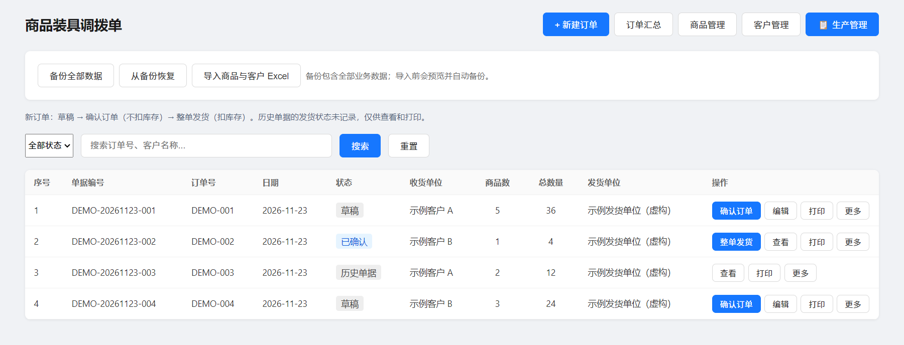
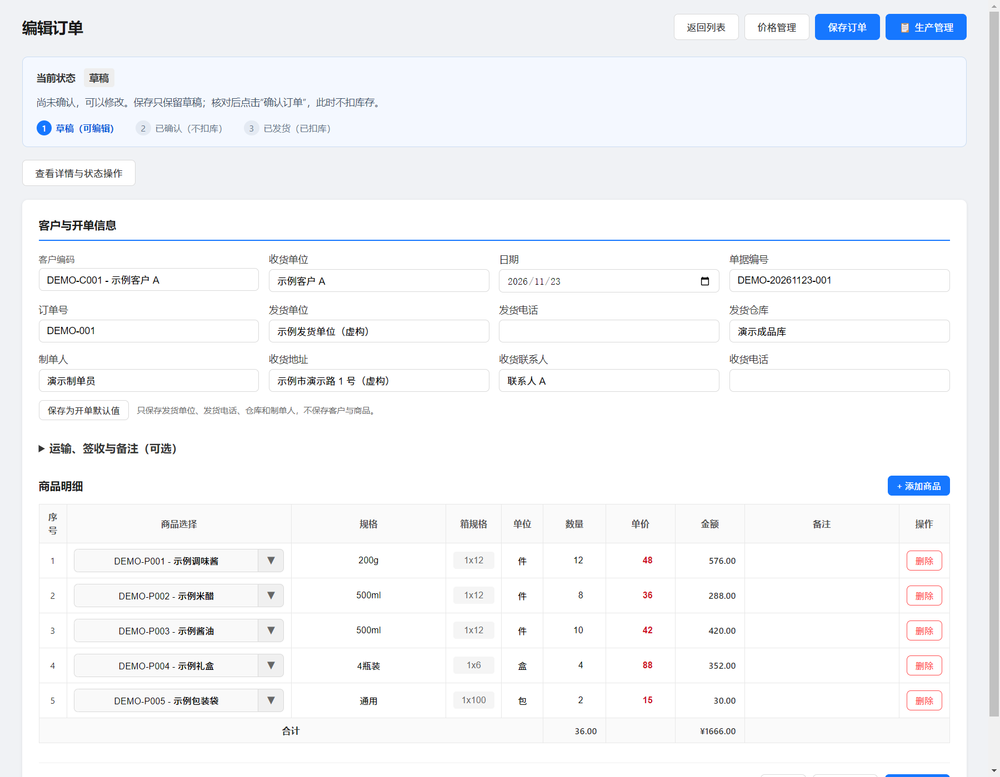
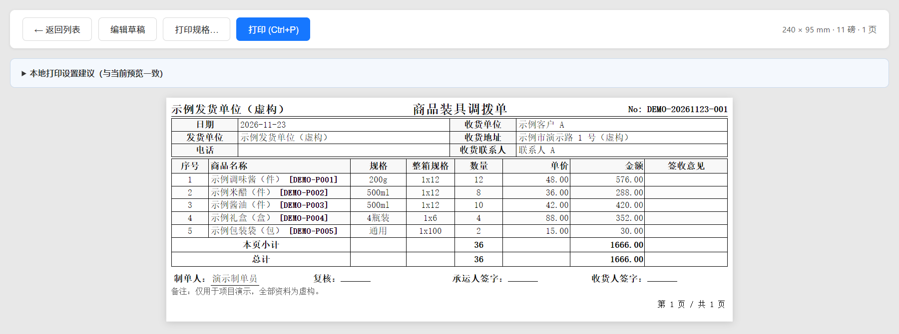
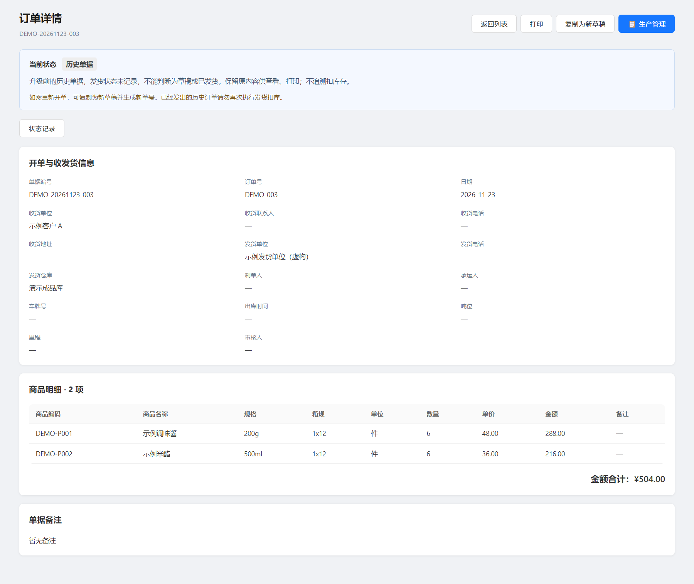
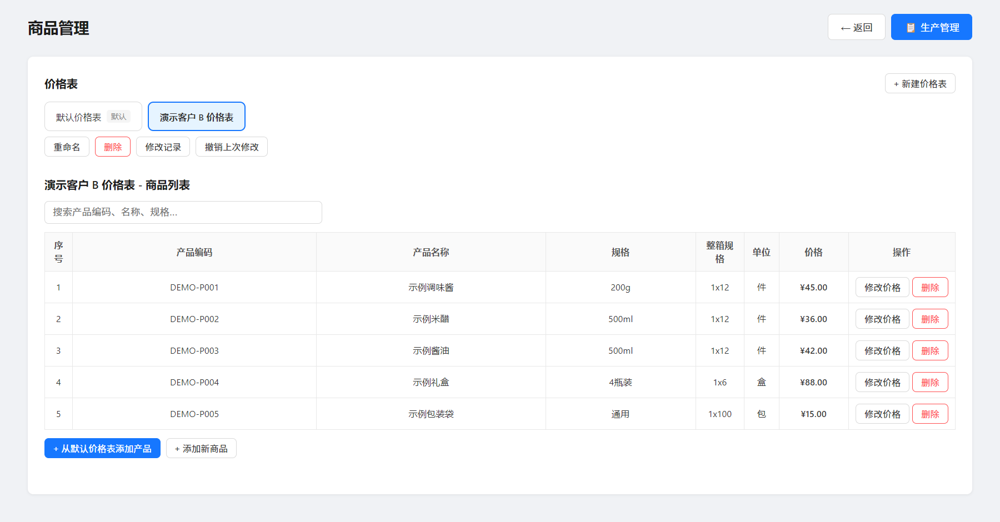
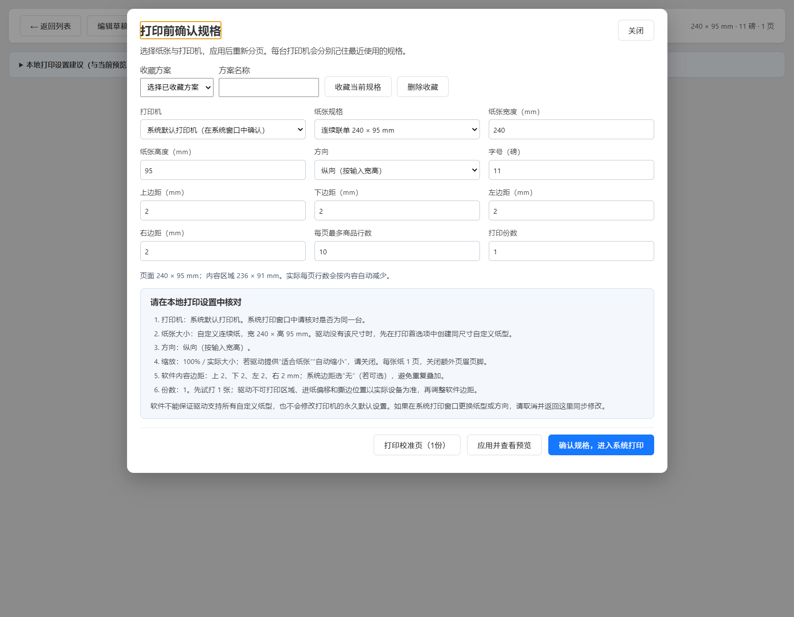
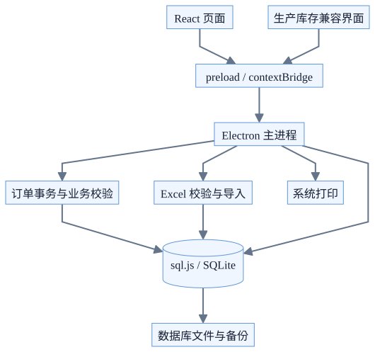

# 本地订单与发货单打印系统

[](https://github.com/ZhangYN1203/dispatch-note-desktop/actions/workflows/ci.yml)
[](LICENSE)

基于 **Electron + React + TypeScript + SQLite** 的 Windows 桌面应用，围绕客户定价、订单录入、纸质发货单和 Excel 汇总构建本地业务流程。

公开演示版：内置商品、客户、发货单位和截图均为虚构资料，不包含实际业务数据或旧版本提交历史。

## 解决的问题

- 客户采用不同价格表，开单时自动带出对应价格，减少重复录入。
- 订单表头和明细统一保存，避免保存中断留下不完整单据。
- 发货单按实际内容和纸张高度分页，支持系统打印机选择。
- 本地数据支持完整备份、恢复及导入失败回滚，便于离线使用。

## 界面预览

### 订单与数据操作



### 订单编辑



### 打印预览



### 单据详情与状态



确认订单和整单发货直接显示在列表及详情；“更多”使用独立操作窗口，避免被表格裁切。历史单据明确说明旧版未记录发货状态。

### 客户定价



### 打印前确认规格



选择打印机后分别记住其规格；先应用到预览，再按窗口中的纸型、方向、缩放和边距建议核对本地设置。详见 [打印设置使用说明](docs/printing.md)。

## 功能

| 模块 | 已实现能力 |
| --- | --- |
| 订单 | 核心字段与折叠选填项、默认值、复制开单、未保存提醒；草稿/确认/发货/作废与状态记录 |
| 客户与商品 | 客户档案、商品规格、默认价格表、客户关联价格表 |
| 定价 | 调价记录、最近一次调价撤销 |
| Excel | 商品与客户导入预览、编码合并、行号报错；订单明细与汇总导出 |
| 打印 | A4/A5/Letter、连续纸和自定义宽高；方向、四边边距、字号、行数与份数可调；打印前确认规格并提示驱动设置；每台设备多套命名收藏与毫米校准页 |
| 数据 | 启动自动备份保留 10 份、手动完整备份、校验后恢复、恢复前备份 |
| 生产库存 | 原材料、供应商、车间、生产任务、成品和库存日志；业务事务、库存不足拦截、重复提交保护；旧 IndexedDB 一次迁移 |

## 技术架构



[查看可编辑的 Mermaid 源文件](docs/architecture.mmd)

渲染进程关闭 Node.js 集成，使用 `contextIsolation` 与明确的 IPC 接口访问本地数据。应用不要求登录或云端数据库。

### 关键实现

**整单事务与落盘失败恢复。** 订单保存通过一个 IPC 请求提交表头和全部明细；主进程验证数量、价格并重新计算行金额。一次业务事务成功后统一导出数据库，通过临时文件替换目标文件。SQL 或写盘失败时恢复提交前状态。

**兼容旧库存数据。** 首次启动读取旧 IndexedDB，在 SQLite 的 `production_records` 中按原数据类型与 ID 保存。迁移和完成标记一起提交，失败可以重试；保留原 IndexedDB。编号分配保留已删除记录及历史引用的高水位，避免旧关系指向新对象。

**订单与库存状态。** 确认订单不扣库存；整单发货时明确选择每项商品的成品批次，数量、流水及订单状态一次提交。已发货作废必须确认整单货物退回，恢复原批次一次。历史单据只读并保留打印和复制入口，商品规格、箱规与价格采用订单快照。详见 [订单与库存使用说明](docs/workflow.md)。

**可恢复的导入流程。** Excel 先解析、校验并展示新增/更新数量，再按编码合并。缺失的可选列保留原值，既有客户价格表及专属定价不会被覆盖；导入前备份，中途失败整批回滚。迁移未完成时禁止生成不完整备份。

**预览与纸张一致。** React 与主进程共享纸张几何和规格校验，测量实际内容并调整每页行数；打印前先确认规格、完成配置保存并等待重新分页，再打开系统打印。测试生成 PDF，核对物理页数和尺寸，避免预览两页、实际多出空白页。

## 快速运行

要求：**Windows 10/11、Node.js 22 LTS、npm**。

```powershell
git clone https://github.com/ZhangYN1203/dispatch-note-desktop.git
cd dispatch-note-desktop
npm ci
npm run electron:dev
```

也可双击 `dev.bat`。首次创建数据库会生成 5 条虚构商品和 3 条虚构客户；不会创建演示订单。可使用这些资料自行开单，也可导入 [演示 Excel](examples/demo-import.xlsx)。

`npm run dev` 只启动 Vite，业务功能依赖 Electron 的 IPC 接口，应使用 `npm run electron:dev`。

## 测试与构建

```powershell
npm test                  # 真实 sql.js 临时数据库回归测试
npm run check:public      # 演示数据与待发布文件检查
npm run typecheck         # 前端与主进程 TypeScript 检查
npm run build:vite        # 类型检查与前端生产构建
npm run test:electron     # 临时 userData 中的 Electron 集成测试
npm run electron:build    # Windows NSIS 安装包
npm run electron:build:dir # Windows 目录版
```

回归测试覆盖订单/导入/磁盘失败回滚、库存事务与重复请求、状态校验与退回、旧库升级原文件备份、快照、历史编号、备份结构校验及导入缺失列。Electron 集成测试验证实际 IndexedDB 迁移、取消编辑、备份恢复、首页导入、打印错误提示，以及连续纸、自定义宽高、A4/A5 横向、字号和边距变化、空订单的 PDF 物理尺寸与分页。

测试只使用临时目录。打印失败提示通过模拟打印机回调验证，不会向真实打印机发送任务。

GitHub Actions 在 Windows 上运行文件检查、回归测试、类型检查、生产构建和 Electron 集成测试。打包输出位于 `release/`，不提交到源码仓库。当前安装包未签名，未使用自定义图标。

## 数据与备份

演示版使用独立应用标识 `io.github.zhangyn1203.dispatch-note-desktop`，数据保存在 Electron 的 `userData` 目录。Windows 通常为 `%APPDATA%/发货单打印演示版/`，开发环境通常为 `%APPDATA%/dispatch-note-desktop/`。实际路径以启动日志为准。

- `orders.db`：订单、客户、商品、价格表和生产库存兼容记录。
- `backups/`：自动备份、导入前备份、恢复前备份和首次升级原文件备份（`*-schema-upgrade.db`）。升级原文件仅供配合旧版回退，不通过当前版本的完整备份恢复入口使用。
- 首页可手动备份或恢复。恢复会覆盖当前数据，先确认并备份，再校验文件完整性、表结构与库存迁移状态。
- 仅支持当前版本创建的完整备份；旧 IndexedDB 来源取决于原应用的数据目录及页面来源。

## 项目结构

```text
electron/     主进程、数据库、事务、导入、库存兼容与打印配置
src/          React 页面、组件、类型和 IPC 封装
public/       生产库存兼容界面
tests/        数据回归与 Electron 集成测试
scripts/      发布检查、演示截图工具
examples/     虚构 Excel 导入样例
docs/         架构说明与演示截图
.github/      Windows CI
```

## 已知限制与后续方向

- 生产库存仍使用旧模块界面；在用库存统一写入 `production_records`，旧备用 SQL 库存表保留归档并提示核对，不按名称自动合并。
- 当前发货按整单、每项选择一个成品批次；暂不支持分批发货、拆分批次和部分退货。历史单据不追溯状态和扣库；箱规只能以升级时现存资料补齐一次。
- 当前面向单机使用，没有多用户并发与跨设备同步设计。
- 金额基于 JavaScript 数值并按行保留两位小数，未引入完整十进制定点方案。
- 打印已验证 Chromium PDF 输出；实体打印机的驱动、进纸和纸张偏移需要实机校准。
- 第三方依赖需要持续维护，未将此演示版本描述为经过完整安全审计的生产系统。

贡献前请阅读 [贡献说明](CONTRIBUTING.md)，安全问题请查看 [安全说明](SECURITY.md)。项目遵循 [MIT License](LICENSE)。
