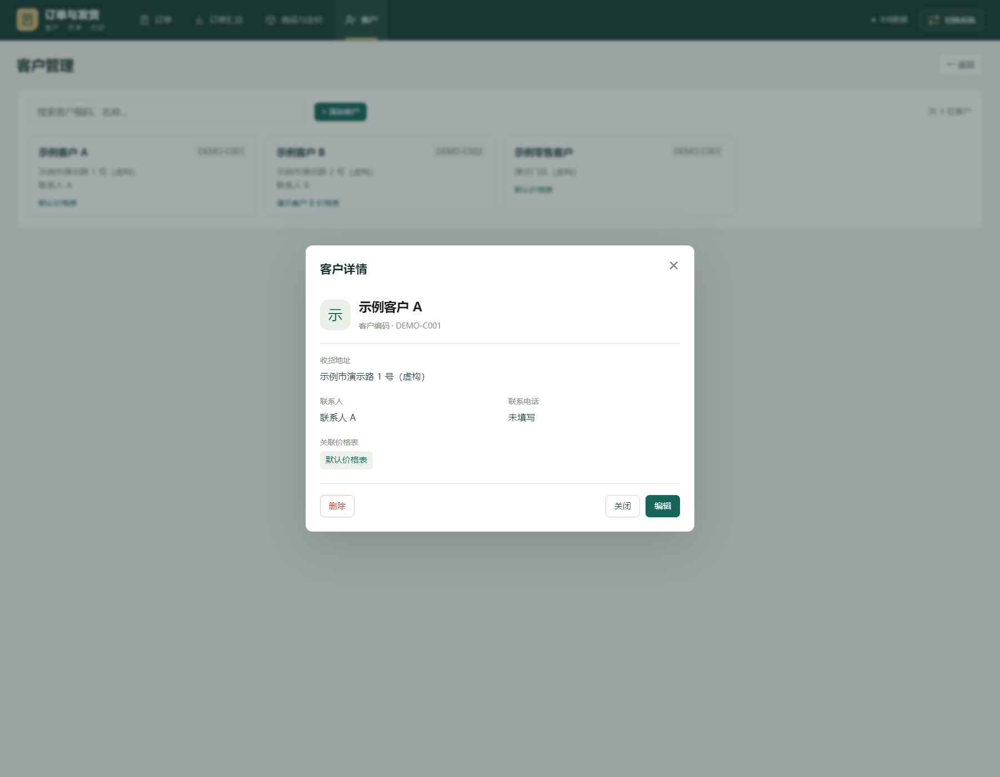
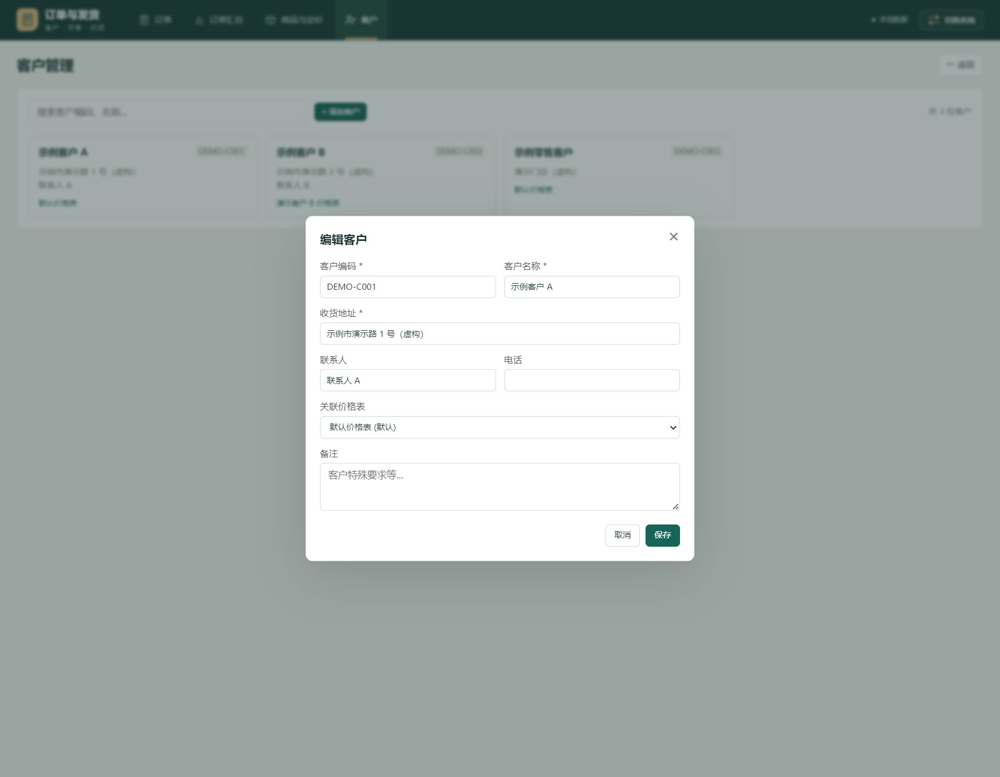

# 客户弹窗交互 · 1.4.3

2026-11-28：客户列表持续保留，点击卡片后在中央显示详情，不再把列表替换成整页详情。

- 详情、添加、编辑和删除确认统一在弹窗完成。
- 支持右上角 ×、空白遮罩及 Esc；点击弹窗内部不会关闭。
- 编辑有改动时，关闭前确认是否放弃；保存中禁用关闭与重复提交。
- 关闭详情保留列表搜索、滚动位置并恢复卡片焦点，Tab 在弹窗内循环。
- 资料分组紧凑展示；增加搜索清空、匹配数量和空结果恢复。
- 必填空白、重复编码和保存失败在弹窗内显示，失败不丢失表单内容。
- 更新和删除后继续按原关键词展示，快速搜索只接受最新响应。
- 小窗口支持滚动和单列编辑表单。





## 验证

`tests/electron-customer-dialog.cjs` 的 11 组界面检查通过，包括空白、右上角和键盘关闭，编辑确认，空白必填及重复编码，模拟失败，快速搜索晚到响应，删除取消及确认，长列表滚动和焦点，小窗口宽高。

另外复验 `tests/electron-catalog-audit.cjs` 14 组与 `tests/electron-smoke.cjs` 21 组。类型检查、构建及公开文件检查通过。新弹窗脚本对自用版和独立版实际打包资源分别复验通过；独立版首次启动仍为空。

测试使用临时用户目录，不读写真实业务库；公开截图和源码继续只包含虚构资料。

复验命令：

```sh
npm run build:vite
electron tests/electron-customer-dialog.cjs
electron tests/electron-catalog-audit.cjs
npm run test:electron
```

后续可考虑在客户详情里提供“为此客户开单”和“查看历史订单”，减少重复搜索；本次先落实详情与编辑的交互，不新增这些业务入口。
